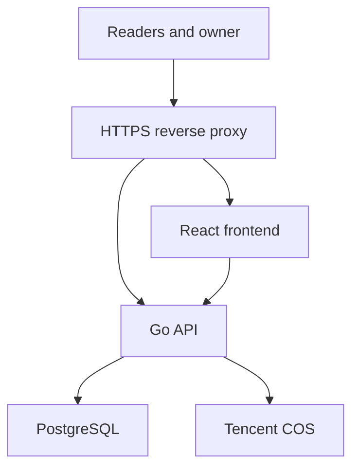

# Blog system development plan

Status: Development workflow and monorepo approach approved by the owner. Remaining product and technology proposals are tracked in the owner review checklist.

## 1. Product goals

Build a personal blog for journals, technical articles, and portfolio content. The frontend must have an artistic, distinctive visual identity informed by references the owner selects from Awwwards. Design is a core workstream, including typography, composition, motion, and interaction.

Requirements from `AGENTS.md`:

- Write in Typora, upload Markdown, and display it on the blog.
- Support public and private articles.
- Support English as the primary language and articles written in Chinese.
- Provide categories, tags, search, comments, and responsive layouts.
- Track writing, publication, and update dates separately.
- Render Markdown, code blocks, images, links, and LaTeX math.
- Use React for the frontend and Go for the backend.
- Target cloud hosting such as Tencent Cloud. Budget is not currently a constraint.

Implementation begins after review of the scope and architecture. Visual implementation follows review of the design direction.

## 2. Application separation

Decision: Use one repository with independently buildable, testable, and deployable frontend and backend applications. This keeps cross-application changes reviewable together while maintaining explicit boundaries. Separate repositories remain an option if ownership or access needs justify them later.

### Application independence requirements

- Each application has its own dependencies, build commands, tests, container image, and deployment pipeline.
- Frontend and backend changes run their respective CI checks; API contract changes run checks for both.
- The frontend uses the documented API and does not access backend implementation files or the database.
- Each application can be released independently while preserving API compatibility.
- Each release records the deployed frontend and backend artifact versions.
- Add directory-based review ownership when collaborators join. Repository access remains shared; revisit separate repositories if different source access permissions become necessary.

The rationale and reconsideration criteria are recorded in [ADR 0001](docs/architecture/decisions/0001-monorepo.md).

```text
iSaber/
├── AGENTS.md
├── DEVELOPMENT_PLAN.md
├── frontend/                # React and TypeScript; Next.js proposed
├── backend/                 # Go API and database migrations
├── contracts/
│   └── openapi.yaml         # Shared API specification
├── docs/
│   ├── product/             # Requirements and acceptance criteria
│   ├── architecture/        # Architecture and decision records
│   ├── design/              # References and interaction specifications
│   └── operations/          # Deployment, backups, recovery, runbooks
├── infra/                   # Containers and environment configuration
└── .github/workflows/       # CI and delivery, if hosted on GitHub
```

| Frontend owns | Backend owns |
| --- | --- |
| Visual design, motion, and responsive layouts | Article lifecycle and publishing |
| Article rendering and reading experience | Authentication and authorization |
| Administration and upload interface | Markdown import and asset storage |
| Interaction and client-side validation | Authoritative validation and data integrity |
| Accessibility and page metadata | Search, comments, moderation, audit events |

All application data flows through the Go API. Only the backend accesses the database and storage credentials. If Next.js is selected, its server handles presentation and API consumption; Go retains business rules and access control. Client-side hiding is never an authorization mechanism.

### Owner dashboard and accounts

Confirmed decision: the first release has one owner account and no reader accounts or public registration. Private articles are owner-only. Provision the owner through a documented setup command; define sign-in and recovery mechanisms during architecture review.

The React application contains the public blog and a protected `/admin` dashboard for article lists and filters, Markdown uploads, metadata, preview, revisions, publication, categories, tags, and comment moderation. Both sections use the same Go backend and data stores. Each management operation requires backend authorization; route protection alone does not grant security.

The dashboard prioritizes efficient, accessible management; the public blog follows the separately reviewed artistic direction. No separate management service or admin deployment is required. See [ADR 0002](docs/architecture/decisions/0002-owner-dashboard.md).

### Proposed infrastructure



- React with TypeScript; Next.js proposed for server-rendered article pages and page metadata. This requires a Node.js runtime alongside Go.
- One modular Go application exposing a REST API.
- PostgreSQL for Markdown, metadata, revisions, comments, and sessions.
- Tencent COS for images and attachments.
- Containers on Tencent CVM, with managed PostgreSQL proposed.
- Same-origin routing for the website and API where practical, simplifying session handling.

Record final technology choices and their tradeoffs in architecture decision records before scaffolding.

## 3. Requirements and acceptance criteria

The first-release [product requirements document](docs/product/requirements.md) is drafted for owner review. It distinguishes confirmed inputs from proposed defaults and includes acceptance criteria and outstanding decisions.

Translate product requirements into a prioritized backlog. Each feature must define:

- User journey and expected outcome.
- Observable acceptance criteria.
- Permission rules.
- Loading, empty, error, and recovery states.
- First-release scope and explicit exclusions.

For Markdown import, define behavior for missing images, invalid files, duplicate slugs, revision uploads, unsupported syntax, and partial upload failures.

**Review gate:** Owner approves the first-release scope and unresolved product decisions.

## 4. API contract and independent development

Use OpenAPI as the shared API contract. Specify endpoints, schemas, authentication, pagination, errors, and examples before connecting the applications.

- Generate a TypeScript API client and types from the contract.
- Provide mock responses so frontend development can proceed independently.
- Verify backend behavior against the contract using contract tests.
- Check generated-client consistency and API compatibility in CI.
- Review shared behavior changes as contract changes before implementation.
- Preserve compatibility across independent frontend and backend releases.

**Review gate:** Approve the domain model, API conventions, and initial contract.

## 5. Frontend design workflow

```text
Owner-provided references
  → reference analysis
  → visual directions
  → selected direction
  → interactive prototype
  → reusable components
  → complete page layouts
```

Analyze which qualities appeal to the owner in each reference, then establish a coherent visual language for this blog. Define typography, color, spacing, layout, components, motion, and interaction states.

| Representative screen | Purpose |
| --- | --- |
| Homepage and portfolio | Validate identity, composition, navigation, and motion |
| Article page | Validate long-form reading, code, math, English, and Chinese |
| Categories and search | Validate content discovery and result states |
| Mobile layouts | Validate touch interactions, typography, and navigation |
| Upload and preview | Validate the owner's publishing workflow |

Use realistic long articles and varied content during design review. Agree on accessibility and performance targets, keyboard interaction, reduced-motion behavior, and browser coverage before implementing substantial visual effects.

Backend work can proceed while the design prototype is refined. Frontend work uses API mocks until integration.

**Review gate:** Owner approves the visual direction and representative interactive prototype before the design is extended across the site.

## 6. Proposed content and publishing behavior

These are proposals to resolve during product review:

- Upload a Markdown file, or a ZIP containing Markdown and its image folder.
- Validate imports, store assets, and rewrite relative image references to managed asset links.
- Create drafts by default; preview before publication.
- Support optional YAML front matter and an equivalent metadata form.
- Update existing articles through an explicit revision workflow; preserve their URLs and earlier revisions.
- Keep status (`draft`, `published`) separate from visibility (`public`, `private`).
- Store `written_at`, `published_at`, and `updated_at` separately. Specify which changes update each date.
- Permit English and Chinese articles without requiring paired translations.
- Retain Markdown as the source of truth; define one rendering specification for preview and published pages.

Privacy must cover article bodies, metadata, images, attachments, revisions, search, feeds, sitemaps, and caches. Draft and private responses must not enter shared public caches. Private media requires backend authorization or an explicitly approved temporary-link policy.

## 7. Delivery milestones

| Milestone | Reviewable outcome |
| --- | --- |
| 0. Planning | Approved scope, system boundaries, architecture decisions, and initial API contract |
| 1. Foundation | Both applications run locally; migrations, API tooling, and CI work |
| 2. First publishing flow | Owner setup and login work; `/admin` supports upload with images, preview, publication, and reading through the same Go backend |
| 3. Reading experience | Approved design displays real articles, code, math, and responsive layouts |
| 4. Content organization | Categories, tags, dates, English/Chinese content, and search work |
| 5. Privacy and comments | Private access rules, comment submission, and moderation work |
| 6. Release readiness | Staging acceptance, backup restoration, monitoring, and deployment procedures are verified |

Integrate early through the first publishing flow. Keep privacy rules in the foundation and every data-access path; milestone 5 completes their user-facing workflows and broader verification.

## 8. Change and review workflow

```text
Issue with acceptance criteria
  → short-lived feature branch
  → implementation and relevant tests
  → pull request
  → automated checks and review
  → merge to main
  → staging verification
  → production release
```

- Keep pull requests focused and small enough to review effectively.
- Include the problem, resulting behavior, validation, and relevant migration or operational details in each pull request.
- Protect `main` with required checks.
- Require independent approval when another reviewer is available. For solo work, use a documented review checklist without requiring an unavailable second reviewer.
- Record significant architecture decisions and update affected documentation with the change.
- Keep credentials out of source control and examples.

## 9. Automated quality checks

| Area | Checks |
| --- | --- |
| Frontend | Type checking, linting, production build, critical interaction tests |
| Backend | Formatting, static analysis, unit tests, database integration tests |
| API | Contract validation, generated-client consistency, compatibility checks |
| Integration | Upload → preview → publish → read; important failure and recovery paths |
| Privacy | Unauthorized users cannot retrieve private articles, metadata, revisions, or media |
| UI | Responsive behavior, keyboard access, and visual regression checks for stable screens |
| Dependencies | Secret detection and vulnerability scanning with actionable findings reviewed |

Tests should verify behavior and meaningful failure cases. Prioritize authorization, Markdown import, persistence, and publishing integrity. Define representative content fixtures covering English, Chinese, math, code, and local images.

## 10. Environments and releases

Maintain local, staging, and production environments with separate configuration, secrets, databases, and storage. Staging should resemble production and use non-sensitive test content.

- Build versioned artifacts once and promote the tested artifacts.
- Deploy to staging after merge and release to production after acceptance.
- Use backward-compatible database migrations so frontend and backend can be released independently.
- Record application artifact versions, contract compatibility, and migration versions for each release.
- Document application rollback separately from database recovery. Database migrations are not assumed to be safely reversible.
- Configure automated database backups and object recovery settings; verify restoration before launch.
- Add health and readiness checks, structured logs, request identifiers, error reporting, and operational alerts. Avoid logging private article content or credentials.
- Provide deployment, incident response, backup, and recovery runbooks.

## 11. Definition of done

A change is complete when:

- Acceptance criteria are satisfied.
- Relevant automated checks pass.
- Code and user-visible behavior have been reviewed.
- Applicable API contracts, generated clients, and documentation are current.
- Staging verification passes.
- Required migration, monitoring, rollback, and recovery details are documented.

## 12. Owner review checklist

- [x] Use one repository with independently buildable, testable, and deployable frontend and backend projects.
- [ ] Confirm React + TypeScript, with Next.js proposed for presentation.
- [ ] Confirm Go REST API, PostgreSQL, and COS as the proposed backend foundation.
- [x] Use one owner account with owner-only private articles; defer reader accounts and public registration.
- [x] Manage content through `/admin` in the React application and the same Go backend; provision the owner through a setup command.
- [ ] Define the comment model without reader accounts: guest comments with owner moderation or an external provider that permits guest submissions.
- [ ] Confirm Markdown/image import and revision behavior.
- [ ] Define the first-release search expectations, including Chinese search quality.
- [ ] Supply design references and review the prototype before visual implementation.
- [ ] Confirm the Git hosting and CI provider; GitHub is proposed.
- [ ] Confirm target hosting region and operational requirements before deployment design is finalized.
- [ ] Approve the milestone order and first-release scope.

## References

- [OpenAPI specification](https://spec.openapis.org/oas/latest.html): language-independent HTTP API contracts.
- [GitHub branch protection](https://docs.github.com/en/repositories/configuring-branches-and-merges-in-your-repository/managing-protected-branches/about-protected-branches): required checks and review rules.
- [Google engineering practices: small changes](https://google.github.io/eng-practices/review/developer/small-cls.html): keeping changes reviewable.
- [Next.js server and client components](https://nextjs.org/docs/app/getting-started/server-and-client-components): proposed frontend rendering model.
