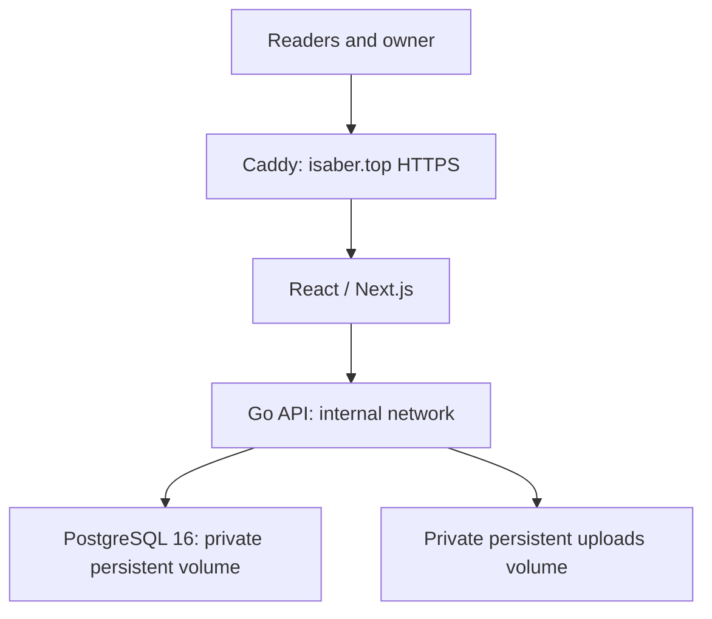

# Blog system development plan

Status: Updated November 11, 2026. Core features and automatic Tencent delivery are implemented. Merge-check configuration, live rollback rehearsal, browser acceptance and final page design are the next priorities; see the backlog and owner checklist.

## 1. Product goals

Build a personal blog for journals, technical articles, and portfolio content. The frontend must have an artistic, distinctive visual identity informed by references the owner selects from Awwwards. Design is a core workstream, including typography, composition, motion, and interaction.

Requirements from `AGENTS.md`:

- Write in Typora, upload Markdown, and display it on the blog.
- Support public and private articles.
- Support English as the primary language and articles written in Chinese.
- Provide categories, tags, search, comments, and responsive layouts.
- Track writing, publication, and update dates separately.
- Render Markdown, code blocks, images, links, and LaTeX math.
- Use React for the frontend and Go for the backend.
- Target cloud hosting such as Tencent Cloud. Budget is not currently a constraint.

The approved core scope and architecture are implemented. Vivid Home and its motion are integrated after owner review; further page design and browser acceptance remain.

The [implementation backlog](docs/product/backlog.md) tracks progress. Core authentication, publishing, images, revisions, organization, search, and comments are merged. Artistic design remains under review. The owner approved replacing the former relay, staging, and backup framework with [one workflow and one Tencent deployment](docs/architecture/decisions/0019-simple-delivery.md). The Tencent blog now runs at `https://isaber.top` over trusted HTTPS with private persistent volumes and preserved JD content. The owner approved automatic delivery from successful main builds, and it is enabled.

## 2. Application separation

Decision: Use one repository with independently buildable, testable, and deployable frontend and backend applications. This keeps cross-application changes reviewable together while maintaining explicit boundaries. Separate repositories remain an option if ownership or access needs justify them later.

### Application independence requirements

- Each application has its own dependencies, build commands, tests, container image, and versioned release reference. One shared workflow coordinates delivery.
- Frontend and backend changes run their respective CI checks; API contract changes run checks for both.
- The frontend uses the documented API and does not access backend implementation files or the database.
- Each application can be released independently while preserving API compatibility.
- Each release records the deployed frontend and backend artifact versions.
- Add directory-based review ownership when collaborators join. Repository access remains shared; revisit separate repositories if different source access permissions become necessary.

The rationale and reconsideration criteria are recorded in [ADR 0001](docs/architecture/decisions/0001-monorepo.md).

```text
iSaber/
├── AGENTS.md
├── DEVELOPMENT_PLAN.md
├── frontend/                # React, TypeScript, and Next.js
├── backend/                 # Go API and database migrations
├── contracts/
│   └── openapi.yaml         # Shared API specification
├── docs/
│   ├── product/             # Requirements and acceptance criteria
│   ├── architecture/        # Architecture and decision records
│   ├── design/              # References and interaction specifications
│   └── operations/          # Deployment and operator runbooks
├── infra/                   # Containers and environment configuration
└── .github/workflows/       # CI and delivery, if hosted on GitHub
```

| Frontend owns | Backend owns |
| --- | --- |
| Visual design, motion, and responsive layouts | Article lifecycle and publishing |
| Article rendering and reading experience | Authentication and authorization |
| Administration and upload interface | Markdown import and asset storage |
| Interaction and client-side validation | Authoritative validation and data integrity |
| Accessibility and page metadata | Search, comments, moderation, audit events |

All application data flows through the Go API. Only the backend accesses the database and storage credentials. Next.js handles presentation and API consumption; Go retains business rules and access control. Client-side hiding is never an authorization mechanism.

### Owner dashboard and accounts

Confirmed decision: the first release has one owner account and no reader accounts or public registration. Private articles are owner-only. Setup, recovery, and session mechanisms merged in PR #5 and are documented in [ADR 0005](docs/architecture/decisions/0005-owner-authentication.md) and the [owner operations guide](docs/operations/owner-account.md).

The React application contains the public blog and a protected `/admin` dashboard for article lists and filters, Markdown uploads, metadata, preview, revisions, publication, categories, tags, and comment moderation. Both sections use the same Go backend and data stores. Each management operation requires backend authorization; route protection alone does not grant security.

The dashboard prioritizes efficient, accessible management; the public blog follows the separately reviewed artistic direction. No separate management service or admin deployment is required. See [ADR 0002](docs/architecture/decisions/0002-owner-dashboard.md).

### Current infrastructure



- React with TypeScript and Next.js for server-rendered pages and metadata, merged in PR #3. The deployed frontend uses a separate Node.js container.
- One modular Go application exposing a REST API.
- PostgreSQL 16 with pgx/Goose stores Markdown, metadata, revisions, comments and sessions. Five migrations are applied; runtime and operator roles are separate.
- The Go filesystem adapter stores images and staged uploads in a private persistent volume. COS is unimplemented optional storage work; it is not required by the current single-host deployment.
- One Docker Compose project on Tencent CVM hosts the proxy, frontend, API and database; host PostgreSQL and other existing workloads remain separate.
- Caddy forwards to Next.js, which rewrites `/api/*` to Go. Browser traffic stays on the public HTTPS origin.

The original persistence choice is recorded in [ADR 0004](docs/architecture/decisions/0004-postgresql-and-private-storage.md); [ADR 0019](docs/architecture/decisions/0019-simple-delivery.md) and the deployment guide describe the accepted single-host operation.

## 3. Requirements and acceptance criteria

The first-release [product requirements document](docs/product/requirements.md) is approved as the product baseline, including its documented defaults, acceptance criteria, and deferred scope. Its Section 9 lists outstanding design inputs and unspecified targets. The logical data model and API contract are also owner-approved; remaining implementation choices require documentation.

The [prioritized backlog](docs/product/backlog.md) maps the approved requirements to merged work and remaining acceptance. Each new feature must define:

- User journey and expected outcome.
- Observable acceptance criteria.
- Permission rules.
- Loading, empty, error, and recovery states.
- First-release scope and explicit exclusions.

For Markdown import, define behavior for missing images, invalid files, duplicate slugs, revision uploads, unsupported syntax, and partial upload failures.

**Review gate:** Owner approves the first-release scope and unresolved product decisions.

## 4. API contract and independent development

Use OpenAPI as the shared API contract. Specify endpoints, schemas, authentication, pagination, errors, and examples before connecting the applications.

Approved baselines are available in the [data model](docs/architecture/data-model.md), [API design](docs/architecture/api-design.md), and [OpenAPI contract](contracts/openapi.yaml). The [contract guide](contracts/README.md) includes validation instructions. The owner approved these documents and the API contract. Implemented endpoints and remaining work are recorded in the backlog and publishing guide. The API requires PostgreSQL schema version 5.

- Generate a TypeScript API client and types from the contract.
- Provide mock responses so frontend development can proceed independently.
- Verify backend behavior against the contract using contract tests.
- Check generated-client consistency and API compatibility in CI.
- Review shared behavior changes as contract changes before implementation.
- Preserve compatibility across independent frontend and backend releases.

**Review gate:** Approve the domain model, API conventions, and initial contract.

## 5. Frontend design workflow

```text
Owner-provided references
  → reference analysis
  → visual directions
  → selected direction
  → interactive prototype
  → reusable components
  → complete page layouts
```

Analyze which qualities appeal to the owner in each reference, then establish a coherent visual language for this blog. Define typography, color, spacing, layout, components, motion, and interaction states.

| Representative screen | Purpose |
| --- | --- |
| Homepage and portfolio | Validate identity, composition, navigation, and motion |
| Article page | Validate long-form reading, code, math, English, and Chinese |
| Categories and search | Validate content discovery and result states |
| Mobile layouts | Validate touch interactions, typography, and navigation |
| Upload and preview | Validate the owner's publishing workflow |

Use realistic long articles and varied content during design review. Agree on accessibility and performance targets, keyboard interaction, reduced-motion behavior, and browser coverage before implementing substantial visual effects.

The integrated frontend uses the real Go API. Mocks remain useful for isolated tests and design studies; remaining page design can proceed alongside browser acceptance.

**Review gate:** Owner approves the visual direction and representative interactive prototype before the design is extended across the site.

## 6. Implemented content and publishing behavior

These behaviors are approved in the PRD:

- Upload a Markdown file, or a ZIP containing Markdown and its image folder.
- Validate imports, store assets, and rewrite relative image references to managed asset links.
- Create drafts by default; preview before publication.
- Support optional YAML front matter and an equivalent metadata form.
- Update existing articles through an explicit revision workflow; preserve their URLs and earlier revisions.
- Keep status (`draft`, `published`) separate from visibility (`public`, `private`).
- Store `written_at`, `published_at`, and `updated_at` separately. Specify which changes update each date.
- Permit English and Chinese articles without requiring paired translations.
- Retain Markdown as the source of truth; define one rendering specification for preview and published pages.

Privacy must cover article bodies, metadata, images, attachments, revisions, search, feeds, sitemaps, and caches. Draft and private responses must not enter shared public caches. Private media requires backend authorization or an explicitly approved temporary-link policy.

## 7. Delivery milestones

| Milestone | Reviewable outcome |
| --- | --- |
| 0. Planning | Approved scope, system boundaries, architecture decisions, and initial API contract |
| 1. Foundation | Both applications run locally; migrations, API tooling, and CI work |
| 2. First publishing flow | Owner setup and login work; `/admin` supports upload with images, preview, publication, and reading through the same Go backend |
| 3. Reading experience | Approved design displays real articles, code, math, and responsive layouts |
| 4. Content organization | Categories, tags, dates, English/Chinese content, and search work |
| 5. Privacy and comments | Private access rules, comment submission, and moderation work |
| 6. Release readiness | Container acceptance, public HTTPS, persistent storage, and application rollback are verified |

Integrate early through the first publishing flow. Keep privacy rules in the foundation and every data-access path; milestone 5 completes their user-facing workflows and broader verification.

## 8. Change and review workflow

```text
Issue with acceptance criteria
  → short-lived feature branch
  → implementation and relevant tests
  → pull request
  → automated checks and review
  → merge to main
  → main checks and image publication
  → enabled Tencent deployment and HTTPS verification
```

- Group related features into one reviewable milestone PR, as requested by the owner. Continue implementation and validation on the same branch with focused local commits; do not require a push/create/review/merge cycle after each small feature.
- The content-discovery milestone combined category/tag management, public browsing, and English/Chinese search in PR #9. The comments milestone combined guest submission, approved reading, owner moderation, and article controls in PR #10. The delivery milestone simplifies deployment around the already-tested application images. Open or update one PR when the milestone is ready for owner review.
- Keep each milestone coherent and reviewable; use the PR summary to describe the final behavior and combined validation evidence.
- Include the problem, resulting behavior, validation, and relevant migration or operational details in each pull request.
- Protect `main` with required checks.
- Require independent approval when another reviewer is available. For solo work, use a documented review checklist without requiring an unavailable second reviewer.
- Record significant architecture decisions and update affected documentation with the change.
- Keep credentials out of source control and examples.

## 9. Automated quality checks

| Area | Checks |
| --- | --- |
| API contract | OpenAPI structure/references, examples and declared owner security requirements |
| Frontend | Type checking, linting, production build and HTTP smoke tests |
| Backend | Formatting, static analysis, race/unit tests and real PostgreSQL integration tests |
| Containers | Native Caddy/config validation, deployer failure tests, image builds, runtime-role grants, readiness, SSR/assets, authorization, outage and restart |
| Live release | Main publishes the same tested images; restricted SSH deployment verifies HTTPS and retains previous references |

Browser/mobile/keyboard and final visual acceptance remain separate from these checks. Generated-client consistency, automated visual regression and a dedicated dependency/secret-scanning CI job are future quality work; they are not reported as existing checks.

Tests should verify behavior and meaningful failure cases. Prioritize authorization, Markdown import, persistence, and publishing integrity. Define representative content fixtures covering English, Chinese, math, code, and local images.

## 10. Environments and releases

The owner revised operational scope on November 11, 2026: keep local/CI synthetic testing and one Tencent deployment. Remove separately deployed JD staging, custom image transport, and automated backup/offsite/retention services. [ADR 0019](docs/architecture/decisions/0019-simple-delivery.md) supersedes the earlier operational design. See [CI/CD](docs/operations/github-cicd.md) and [deployment](docs/operations/deployment.md).

- Build application images once in CI, test them, and push the same images to GHCR on main.
- Pull public images through NJU by exact digest; send only digests through restricted SSH.
- Delivery is enabled after accepted Tencent capacity/storage, trusted IP HTTPS, dedicated credentials and the JD content cutover. The purchased `isaber.top` domain is canonical, with `www` redirected to it.
- Preserve database, private uploads, and certificate volumes across updates.
- Apply migrations explicitly with operator credentials; review compatibility with the previous application images.
- Verify readiness/HTTPS and restore previous application images on failed activation. Data and schema rollback remain separate operator decisions.
- Keep operational logs private and retain health/readiness endpoints.
- JD staging containers and obsolete schedules are stopped; their stored content and archives remain. Automated staging/backups are outside the revised scope.

## 11. Definition of done

A change is complete when:

- Acceptance criteria are satisfied.
- Relevant automated checks pass.
- Code and user-visible behavior have been reviewed.
- Applicable API contracts, generated clients, and documentation are current.
- Relevant container acceptance and, for enabled live releases, HTTPS verification pass.
- Applicable migration, persistent-storage, and application rollback details are documented.

## 12. Owner review checklist

- [x] Use one repository with independently buildable, testable, and deployable frontend and backend projects.
- [x] Approve the logical data model, API design, and OpenAPI contract.
- [x] Translate the approved requirements into the implementation backlog and maintain completion evidence.
- [x] Merge the React/TypeScript/Next.js foundation and successful CI checks in PR #3.
- [x] Merge the PostgreSQL/pgx/Goose foundation in PR #4 and accept private persistent volumes for the initial Tencent deployment; defer COS.
- [x] Use one owner account with owner-only private articles; defer reader accounts and public registration.
- [x] Manage content through `/admin` in the React application and the same Go backend; provision the owner through a setup command.
- [x] Use guest comments with a display name and plain text, owner moderation, and no email or reader accounts.
- [x] Use draft-first Markdown/image import and explicit revision updates with stable URLs and history, as defined in the PRD.
- [x] Use the PRD search scope, including literal substring matching for Chinese.
- [x] Supply Home references, select Vivid and positively review the motion prototype before integration.
- [ ] Review the remaining page designs, final copy/fonts and real browser/mobile/keyboard behavior.
- [x] Use GitHub for source hosting and GitHub Actions for CI/CD, with guided owner participation.
- [x] Select Tencent CVM, direct-IP HTTPS and the revised single-host operational scope; verify the live automatic release.
- [ ] Require Frontend, Backend and Containers alongside API contract in the main ruleset.
- [ ] Rehearse an explicit live application rollback.
- [x] Approve the documented milestone order and first-release product scope.

## References

- [OpenAPI specification](https://spec.openapis.org/oas/latest.html): language-independent HTTP API contracts.
- [GitHub branch protection](https://docs.github.com/en/repositories/configuring-branches-and-merges-in-your-repository/managing-protected-branches/about-protected-branches): required checks and review rules.
- [Google engineering practices: small changes](https://google.github.io/eng-practices/review/developer/small-cls.html): keeping changes reviewable.
- [Next.js server and client components](https://nextjs.org/docs/app/getting-started/server-and-client-components): proposed frontend rendering model.
