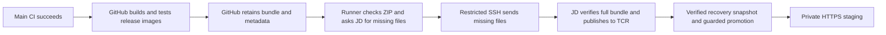

# GitHub delivery to private staging

The workflow in [deploy-staging.yml](../../.github/workflows/deploy-staging.yml) follows successful main image preparation. JD has a dedicated restricted receiver and the GitHub `staging` environment is restricted to `main`. The first complete automatic publish/promotion run requires this workflow to be merged; the real GitHub-to-JD artifact dry run has passed.

## What runs where



Your workstation is no longer required for the automatic path. GitHub builds the applications; JD receives finished content, verifies it, publishes through its existing TCR login, and invokes the existing promotion tool. Tencent production is untouched. No new public listener, self-hosted runner, or paid registry was added.

Normal PRs still run the four CI checks. After a merge, main CI runs, then **Prepare release images**, then **Deploy private staging**. The deployment workflow is not a required pre-merge PR check. Its active job is allowed to finish rather than being canceled halfway through recovery. A newer main commit makes an older bundle stale; JD checks the ref again immediately before switching application images.

## Why only missing files cross the slow link

A real GitHub-hosted SSH probe sent 8 MiB in 62.31 seconds; another run sent 8 MiB in 19.88 seconds. Route performance varies. A complete dry run downloaded and checked the 124.3 MiB source ZIP on the runner, then transferred only **43.3 MiB** after JD seeded its cache from the existing verified application images. JD reconstructed and verified the full bundle; the missing-file transfer took **304.1 seconds**. The site remained on its prior release.

JD independently downloads the small metadata ZIP using the temporary job token and checks it against GitHub's artifact SHA-256/size receipt. It verifies successful preparation/source CI, repository, main ref, run attempt, platform, schema, and the expected file inventory. The runner also checks the full ZIP receipt and compares its metadata with JD's authenticated copy.

The transfer uses a bounded plain tar containing only requested files. JD validates each fixed-size header, path, size, and hash, restores other files only from hash-checked cache entries, then runs complete image/config/layer verification. PAX/GNU extension records, links, special files, duplicate paths, and traversal are rejected. The cache is data under `/opt/isaber-staging/delivery/blobs/`; a filename alone is not proof of valid content.

Only installed root-owned verification/publishing/promotion tools run on JD. The bundle's `.py` files remain authenticated data and are never imported or executed. This prevents an upload from replacing the privileged receiver. Updates to control tools require the existing operator SSH connection and code review.

The cache reduces unchanged content; it does not guarantee a fixed deployment time. New application layers still need to cross the link. Repeated delivery of the exact current artifact is an idempotent no-op. Build reuse across main CI and image preparation remains a separate optimization.

## Identity and credentials

The Linux account is `isaber-deploy`, distinct from both the root operator and the blog owner. Its root-owned authorized-key entry uses `restrict` and a fixed command. Shell commands, SFTP, PTYs, forwarding, and arbitrary Docker commands are unavailable through this key. It has no Docker-group membership. A single exact sudo command launches the root-owned receiver with isolated Python and a time limit.

| Setting | Location | Purpose |
| --- | --- | --- |
| `STAGING_SSH_KEY` | GitHub `staging` environment secret | Dedicated fixed-command key, never the operator's root key |
| `STAGING_HOST`, `STAGING_PORT` | `staging` environment variables | Existing JD SSH destination |
| `STAGING_SSH_HOST_KEY` | `staging` environment variable | Public Ed25519 key pinned through the existing trusted operator SSH connection |
| `STAGING_CD_ENABLED` | Repository variable | Set to `true` to allow new staging jobs |
| `GITHUB_TOKEN` | Automatic read-only job credential | `contents: read` and `actions: read` for independent source/receipt verification |

The job token crosses encrypted SSH stdin and stays in receiver memory. It is never a command-line argument, file, cache entry, or log field. Its requests go only to the fixed GitHub API repository; it is not forwarded to artifact storage. A permanent GitHub token is not installed on JD. The existing TCR credential and staging database/CSRF secrets stay on JD. Runtime backups stay private on JD and are not uploaded as Actions artifacts.

The `staging` environment has a branch policy permitting only `main`, and the job also checks the ref and successful upstream owner/repository. GitHub describes [environment protection](https://docs.github.com/en/actions/how-tos/deploy/configure-and-manage-deployments/manage-environments). SSH host keys are pinned; the workflow does not use blind `ssh-keyscan` or disable verification.

## Operator controls

The application/database compatibility policy from [staging releases](staging-releases.md) remains enforced. Promotion requires a verified restore point and the same reviewed schema/API contract/database image. A failed candidate health gate recovers previous images while preserving live data. A pending image-update journal blocks another promotion until recovery succeeds.

Disable future automatic jobs:

```bash
gh variable set STAGING_CD_ENABLED --repo IiCEight/iSaber --body false
```

Let an active operation finish its health/recovery phase. Inspect the protected delivery log and run `staging.py status`/`verify`; use `recover` if a pending promotion remains. The [manual image relay](image-relay.md) and operator promotion path remain available.

Enable after gateway/environment setup:

```bash
gh variable set TCR_PUBLISH_TRANSPORT --repo IiCEight/iSaber --body relay
gh variable set STAGING_CD_ENABLED --repo IiCEight/iSaber --body true
```

This keeps GitHub-to-TCR direct push disabled. Registry publication takes place on JD.

After the workflow exists on main, a manual retry can use a successful **Prepare release images** run ID:

```bash
gh workflow run deploy-staging.yml --repo IiCEight/iSaber --ref main -f bundle_run_id=RUN_ID
```

For a full receipt/cache verification without publishing or promotion:

```bash
gh workflow run deploy-staging.yml --repo IiCEight/iSaber --ref main -f bundle_run_id=RUN_ID -f verify_only=true
```

A green dry run means `verified`, not deployed. A stale source is reported separately. Successful deployment/no-op and dry-run receipts are retained as small `staging-RUN_ID-ATTEMPT` Actions artifacts for 30 days. They contain image/source metadata, not runtime secrets.

## Installed control files and rotation

The fixed entry is `/usr/local/libexec/isaber-staging-ssh`. Receiver/verification tools live in root-only `/opt/isaber-staging/control/`; the promotion tools remain in `/opt/isaber-staging/config/`. `/etc/sudoers.d/isaber-staging` permits only the exact bounded receiver command. `install_gateway.py` configures this dedicated account/policy from an Ed25519 public key; it does not accept a private key.

For rotation, generate a new dedicated key in private operator storage, install its public key through the existing root SSH connection, replace the `staging` environment secret, verify restricted access, then remove the old key. Keep the public host-key pin synchronized only after authenticated host verification. Do not copy an existing unrestricted root key into Actions. Temporary probe keys/environment were revoked/deleted after acceptance; local temporary private-key copies are removed after setup.

Receiver logs/receipts are under `/opt/isaber-staging/delivery/`. Errors report bounded phase/type/HTTP status, excluding raw headers and secret-bearing command output. Transfers and reconstruction enforce size/disk limits. Cache eviction and delivery-log retention remain operator-managed; clearing the data cache and its `cache-seeded.json` marker while no delivery is active forces a safe reseed/retransfer, without touching live database/uploads/certificates.

Offsite recovery/retention, full-host rebuild acceptance, reviewed schema evolution, and production delivery remain separate work. Staging stays private at `https://localhost:3443` through the [existing access guide](private-staging.md).
