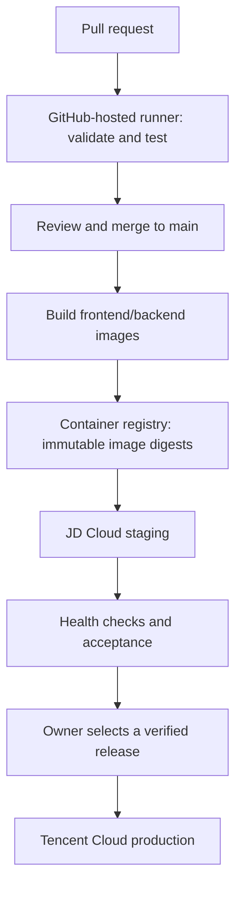

# GitHub CI/CD: guided setup

Status: API contract, Frontend, and Backend checks are merged and have passed through PR #9 and its main run. Deployment remains a plan, not a configured pipeline. Related features now share one milestone PR rather than requiring a merge after each small feature.

Repository: `IiCEight/iSaber`, public, with `main` as the working base. The bootstrap instructions below describe the initial setup; do not repeat them over the existing repository history.

## 1. What we are learning

**Continuous integration (CI)** automatically checks a proposed code change. In this project it validates the API contract and runs frontend/backend checks.

**Continuous delivery (CD)** produces tested, deployable artifacts and promotes them to environments. Our proposed workflow deploys to staging automatically and uses a deliberate production release step. Production is not deployed on every feature push.

GitHub Actions reads workflow YAML from `.github/workflows/`. An event triggers a workflow; the workflow contains jobs; each job runs steps on a runner. An action is a reusable step. An artifact is a build output; a container registry stores deployable images.



Contract validation, frontend checks/builds/HTTP smoke tests, and backend race/PostgreSQL integration checks/builds run on main and PRs. Image builds, staging, production deployment, and rollback remain to be implemented after application and infrastructure readiness are verified.

## 2. Proposed server roles

| Environment | Server | Known capacity | Read-only inspection |
| --- | --- | --- | --- |
| Production | Tencent Cloud, SSH alias `tencent` | Owner reports 4 CPU cores / 4 GB RAM | Ubuntu 24.04.4 LTS, x86_64; Docker command present |
| Staging | JD Cloud, SSH alias `jdcloud` | Owner reports 2 CPU cores / 2 GB RAM | Ubuntu 24.04.2 LTS, x86_64; Docker command not found |

These roles are recommendations pending confirmation of existing workloads. The inspection did not establish available resources, Docker daemon health, firewall policy, DNS, TLS, or registry connectivity. No server configuration was changed.

Use GitHub-hosted runners for CI and image builds. The servers run the application containers rather than building them. Keep staging and production databases, storage, credentials, and application settings separate. Staging uses synthetic content, not production journals. Resource sizing will be revisited before choosing local versus managed database hosting.

## 3. Lesson 1: Run the first CI check

Prepared workflow: [`ci.yml`](../../.github/workflows/ci.yml).

| YAML element | What it does |
| --- | --- |
| `pull_request` | Validates proposed changes against a base branch |
| `push` to `main` | Verifies the merged branch |
| `workflow_dispatch` | Allows a manual run after the workflow exists on the default branch |
| `permissions: contents: read` | Gives CI read-only repository access |
| `concurrency` | Cancels an older CI run for the same PR or branch |
| `runs-on` | Selects a fresh GitHub-hosted Ubuntu runner |
| `uses` | Executes a reusable action pinned to its full commit SHA |
| `run` | Executes a shell command inside the runner |

The job checks the OpenAPI structure, local references, example payloads, selected invalid requests, and declared owner security requirements. It does not test a deployed application or require cloud credentials. It runs for every pull request, including documentation changes, so the required check consistently reports a result.

### Your first exercise

Run these commands in the local project checkout. They publish source and workflow files to a public GitHub repository, so review the content before pushing. The first command bootstraps the currently empty remote with the existing local `main`; it does not merge the feature branches.

```bash
git status --short
git log --oneline --decorate -8
git push -u origin main
git push -u origin ci/github-actions
```

`git push` sends committed history, not uncommitted working-tree changes. Your cloud-server additions to `AGENTS.md` were deliberately left unstaged while preparing this CI change. They are not part of this feature commit.

Then open `https://github.com/IiCEight/iSaber`:

1. Check that `main` is the default branch under repository settings. If the remote is no longer empty, confirm the default branch and compare history before pushing; never force-push to fix an unexpected difference.
2. Open **Pull requests → New pull request**.
3. Select base `main` and compare `ci/github-actions`.
4. Review the diff. Because our planning branches have not been merged into local `main`, this first PR includes the approved PRD and API documents together with CI. This is an intentional initial baseline, not a CI-only change.
5. Create a pull request titled `Establish approved blog specifications and initial CI`.
6. Open its **Checks** tab. Select **API contract**, then inspect the setup, dependency installation, and validation logs.
7. If a run fails, share the failing step and redacted error text. We will diagnose it before merging.

Expected validation output includes `31 operations`, `31 schemas`, `9 fixtures`, and `7 invalid-request checks`. A green check means this contract check passed; it does not mean the blog is implemented or deployed.

If Actions is disabled, use **Settings → Actions → General** to enable the actions needed by this repository, including `actions/checkout` and `actions/setup-python`. This workflow needs no repository secrets or write token permissions. Do not enable write access merely to make this check run.

Stop after seeing the first run. We will review it together and configure protection before merging.

## 4. Lesson 2: Protect main and merge the baseline

After the first successful run, configure a rule targeting `main` under **Settings → Rules → Rulesets** or the available branch-protection interface:

- Require changes through pull requests.
- Require the **API contract** check, selecting the actual check reported by the first run.
- Block force pushes and branch deletion.
- For solo work, do not require approval from a second person who is unavailable. Review the diff and checks before merging.

Verify which rules are active, then merge the baseline PR and confirm CI runs on `main`. Update the local branch with `git switch main` followed by `git pull --ff-only origin main` when the working tree permits. Do not discard local edits to switch branches.

Rules and environment controls depend on repository visibility and GitHub plan. This repository is currently public; reassess available features if its visibility changes.

## 5. Lesson 3: Add application CI

As foundation work introduces runnable applications, extend CI with:

| Component | Checks |
| --- | --- |
| React frontend | Dependency installation from lockfile, types, lint, build, critical interactions |
| Go backend | Formatting, static analysis, unit tests, database integration tests |
| Shared API | Existing contract validation, generated-client consistency, compatibility checks |
| Integration | Owner sign-in and upload → preview → publish → read |

Do not add placeholder jobs that report success without checking an application. Keep a reliable required-check result when adding changed-path optimization later.

## 6. Lesson 4: Prepare staging with guided server steps

Before installation or changes, confirm existing services, free memory/disk, listening ports, firewall rules, domains, and whether the servers can reach the proposed registry. A local SSH alias is not transferred automatically to a GitHub runner.

We will prepare explicit commands based on that inventory, then work through:

1. Create a dedicated deployment identity with narrowly defined privileges. Docker daemon access is powerful; Docker-group membership is effectively host administration and must not be presented as limited access.
2. Install and verify Docker/Compose on JD Cloud; verify the existing Tencent installation.
3. Choose the registry after testing image pulls from both clouds. GHCR is a candidate; a regional registry may be preferable if connectivity is unreliable.
4. Configure separate staging data/storage and server-side runtime secrets.
5. Configure the reverse proxy, DNS, TLS, and health checks. Public staging endpoints use synthetic data; protect the dashboard with owner authentication.
6. Configure deployment connectivity. Prefer an approved private network path or tightly restricted SSH access; do not open SSH to the world just to accommodate hosted-runner IP changes.
7. Pin and verify SSH host keys through a trusted channel. Never disable host-key checking in deployment jobs.

You will enter private keys/tokens directly into GitHub secrets or the appropriate server secret store. Do not paste them into chat, issues, workflow files, or terminal commands that print them. We can inspect names and redacted error messages when troubleshooting.

## 7. Lesson 5: Build and deploy staging

Once applications are runnable:

- On a trusted merge to `main`, run CI and build separate frontend/backend images on GitHub-hosted runners.
- Use immutable image digests in a release manifest, recording frontend/backend commits, contract compatibility, and database migration version.
- Keep registry publishing permissions only in the trusted build job. Untrusted PR checks receive no server deployment credentials or registry publishing access.
- Deploy the tested release to JD Cloud staging, run migrations in a controlled step, start containers, and verify readiness and a representative publishing flow.
- Serialize deployments per environment. Do not cancel a running migration or deployment when a newer build appears.
- Record the deployment outcome. An unsuccessful health check must fail the release process, not be reported as a successful deployment.

GHCR publishing can use the workflow's scoped `GITHUB_TOKEN`; pulling private images on a server requires separately scoped pull access. Cloud API authentication, if needed, should prefer OIDC where the specific provider integration supports it; SSH access alone does not require broad Tencent or JD cloud API keys.

## 8. Lesson 6: Promote to production and practice rollback

Create separate `staging` and `production` GitHub environments when the deployment workflows are ready. Scope variables and secrets to their environment and restrict permitted deployment refs.

For production, use a manual release action selecting a staging-verified release manifest. Promote exactly the tested image digests rather than rebuilding source. Verify that the selected release passed staging before deployment.

Where available, configure required production reviewers. For solo operation, a self-approval rule must not deadlock deployment; do not turn on prevention of self-review unless another reviewer is available. Manual dispatch is a deliberate release trigger, not an independent reviewer approval.

Before the first live deployment:

- Verify database and media backups and restoration.
- Record the previous healthy release and confirm image retention.
- Use migrations compatible with the currently running and rollback application versions.
- Practice redeploying the previous image manifest on staging.
- Treat database recovery separately from application rollback. Never automatically restore an old database backup merely because an application deployment failed.

## 9. Progress checklist

- [x] Inspect repository visibility and server OS/tools without modifying servers.
- [x] Prepare initial contract CI workflow locally.
- [x] Owner pushes the baseline and feature branch, opens the first PR, and observes a real Actions run.
- [ ] Configure branch protection and merge after checks pass.
- [x] Prepare application CI in the foundation branch; observe its first remote run before requiring the new checks.
- [ ] Confirm server roles and existing workloads.
- [ ] Select registry and deployment connectivity after server/network checks.
- [ ] Prepare staging through guided commands.
- [ ] Build images and verify staging deployment.
- [ ] Configure production release and rehearse rollback.

## References

- [GitHub: building and testing Python](https://docs.github.com/en/actions/tutorials/build-and-test-code/python).
- [GitHub: secure use of Actions](https://docs.github.com/en/actions/reference/security/secure-use).
- [GitHub: deployments and environments](https://docs.github.com/en/actions/reference/workflows-and-actions/deployments-and-environments).
- [GitHub: publishing Docker images](https://docs.github.com/en/actions/tutorials/publish-packages/publish-docker-images).
- [GitHub: OIDC in cloud providers](https://docs.github.com/en/actions/how-tos/secure-your-work/security-harden-deployments/oidc-in-cloud-providers).
