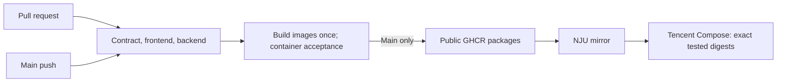

# GitHub CI/CD

One workflow, [ci.yml](../../.github/workflows/ci.yml), validates changes and delivers the same tested images to one Tencent deployment. [ADR 0019](../architecture/decisions/0019-simple-delivery.md) replaces the former staging/relay/backup design. The Tencent blog is live over trusted IP HTTPS; automatic main delivery is enabled with owner approval; see [deployment setup](deployment.md).

**API contract**, **Frontend**, and **Backend** run in parallel. **Containers** waits for all three, builds separate frontend/backend images, and tests them against disposable PostgreSQL using the restricted runtime role. It checks migrations, readiness, SSR/static assets, authorization, database outage, and restart, then removes its synthetic volumes. The frontend job's ordinary build tests the source; deployable images are built once in Containers and never rebuilt during publication or deployment.

Only successful pushes to main publish those existing images to GHCR. An enabled **Deploy blog** job sends two SHA-256 digests over SSH; Tencent pulls the corresponding images through NJU. No image archives, artifact relay, second preparation workflow, staging promotion, or scheduled backup is involved. Manual workflow runs validate only. PRs receive no server credentials and do not publish or deploy images.

Keep API contract, Frontend, Backend, and Containers as required branch checks. PR runs can cancel superseded checks; main runs are serialized and allowed to finish deployment/rollback. Use a production environment restricted to main and pinned SSH host keys. `BLOG_DEPLOY_ENABLED` is unset until host/domain/data acceptance.

The server keeps secrets and persistent data locally. Application updates check readiness and HTTPS; failed activation restores previous application images. Schema migrations and owner recovery use separate operator commands. Rollback does not undo data changes. See [container rehearsal](containers.md) for local checks and [deployment](deployment.md) for setup, installed legacy timer retirement, and rollback.
